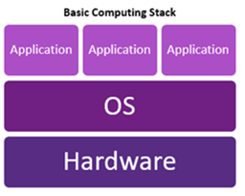
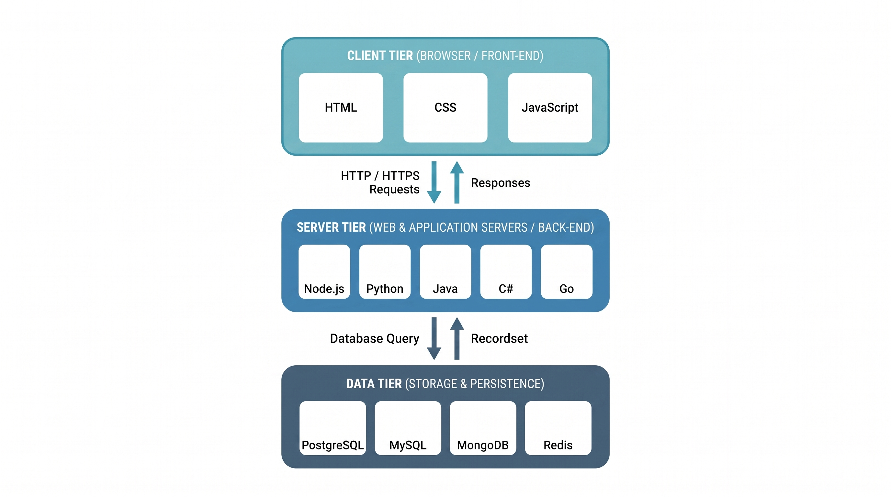
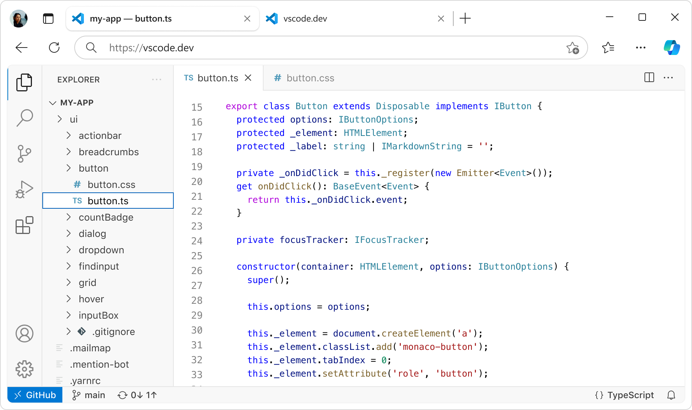
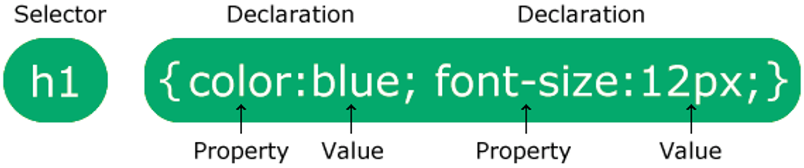
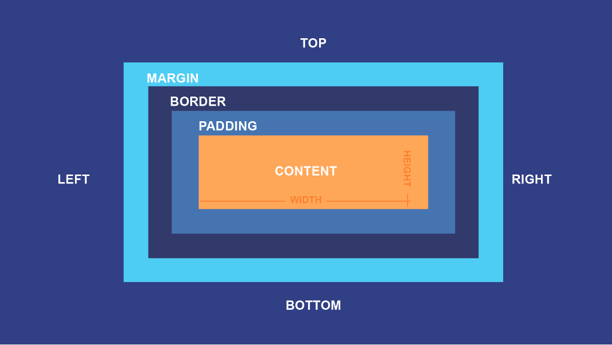
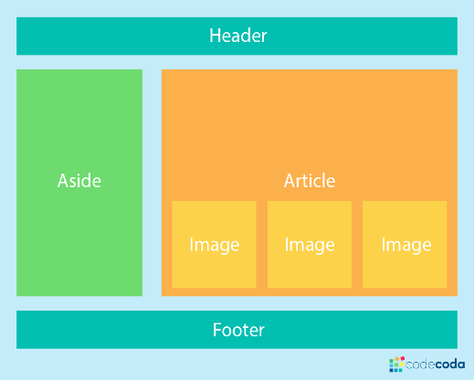

## 1 Introduction to Web Systems

### 1.1 The Computing Stack and the Web Architecture

Software applications operate within a layered hierarchy of abstraction. In traditional standalone computing, software interacts directly with a single device's operating system.



Web applications, by contrast, operate across a distributed client-server architecture:



The three-tier web architecture is the standard software engineering pattern used to decouple modern web applications into three independent, modular layers: the Client Tier (presentation), the Server Tier (application logic), and the Data Tier (persistence).  

At the top, the Client Tier runs in the user's browser, using HTML for structure, CSS for layout, and JavaScript to manage UI interactions and dynamic behavior.

When user actions require data processing or retrieval, the browser dispatches HTTP or HTTPS requests across the network to the middle Server Tier. Here, web and application servers powered by runtimes like Node.js, Python, Java, C#, or Go authenticate requests, enforce business rules, and validate payloads.

Rather than storing state locally, the application server queries the Data Tier—composed of relational or NoSQL database management systems such as PostgreSQL, MySQL, MongoDB, or Redis.

Once the database returns the requested records to the application server, the server processes and packages them into clean formats (typically JSON, HTML, or CSS) and routes the response back to the client browser for rendering.   By maintaining strict separation of concerns among presentation, business processing, and storage, this architecture allows development teams to scale, optimize, and secure each tier independently without rearchitecting the entire system.

### 1.2 How the Web Works: DNS, HTTP/HTTPS, and the Request-Response Cycle

When a user types a Uniform Resource Locator (URL) such as [https://www.example.com/index.html](https://www.example.com/index.html) into a browser, an automated series of network transactions occurs.

1. Domain Name System (DNS) Resolution: Browsers cannot route packets using human-friendly domain names. The browser queries a recursive DNS server to resolve example.com into an Internet Protocol (IP) address (e.g., 93.184.216.34).
2. Transport Connection (TCP/IP & TLS Handshake): The browser initiates a Transmission Control Protocol (TCP) three-way handshake (SYN, SYN-ACK, ACK) with the target server. For secure connections (https://), a Transport Layer Security (TLS) handshake follows, authenticating the server's identity through digital certificates and negotiating symmetric encryption session keys.
3. HTTP Request: The client sends a plaintext (or binary, in HTTP/2 and HTTP/3) request payload containing an HTTP verb, path, and headers:

  ```text
  HTTP
  GET /index.html HTTP/1.1
  Host: <www.example.com>
  User-Agent: Mozilla/5.0 (Windows NT 10.0; Win64; x64)
  Accept: text/html
  ```

Finally, it is the HTTP Response: The web server processes the request, retrieves or generates the resource, and responds with a status code and payload:

  ```text
  HTTP
  HTTP/1.1 200 OK
  Content-Type: text/html; charset=UTF-8
  Content-Length: 1048

  <!DOCTYPE html>
  <html>...</html>
  ```

Common HTTP Status Codes:

- 200 OK: Request succeeded; resource returned.
- 301 Moved Permanently / 302 Found: Redirection to a new URI.
- 400 Bad Request: Malformed request syntax.
- 401 Unauthorized / 403 Forbidden: Missing authentication or insufficient permissions.
- 404 Not Found: The requested resource does not exist on the server.
- 500 Internal Server Error: An unhandled exception occurred on the server.

### 1.3 Data Organization & Hierarchical File Systems

Web servers map URL paths directly or virtually to directory trees on disk:

```text
project-root/
│
├── index.html              <-- Default root page (served at /)
├── about.html              <-- Served at /about.html
│
├── css/
│   └── style.css           <-- Static stylesheet
│
├── js/
│   └── app.js              <-- Front-end JavaScript logic
│
└── assets/
    └── images/
        └── logo.svg        <-- Media asset
```

- Root Directory (/): The topmost directory exposed to the web runtime.
- File Extensions & MIME Types: The suffix (such as `.html`, `.css`, `.js`, `.json`, `.png`) informs the operating system and helps the server send the correct Content-Type header (MIME type, such as text/html, text/css, or application/javascript), instructing the browser how to parse the payload.

### 1.4 The Development Environment

An Integrated Development Environment, commonly known as an IDE, functions as an all-in-one digital workshop for creating software. In the everyday digital world, programs like word processors are designed to produce formatted documents with fonts, margins, and complex layout data. Writing software, however, demands pure, clean text without any hidden background formatting. At its most basic level, an IDE provides this essential plain-text writing space. Yet unlike a simple digital notepad, an IDE understands the rules and grammar of programming languages, turning a blank screen into an active assistant.



As you write, the environment acts much like an intelligent co-author. It applies color-coding to highlight distinct parts of your work, making the structure instantly recognizable. More importantly, it continuously monitors what you type and offers context-aware suggestions. Just as a smartphone anticipates the next word in a text message, an IDE can predict the names of commands, tools, and elements you intend to use. This autocompletion feature relieves programmers of the need to memorize exact spellings or lengthy references, catching subtle typos before they can cause trouble.

Beyond assisting with writing, an IDE brings code to life by letting creators execute their programs directly within the workspace. Instead of manually juggling separate technical tools to launch and test a project, a developer can run their work with a single click. When something does not behave as intended, the IDE’s built-in troubleshooting system—known as a debugger—acts as a diagnostic microscope. It allows creators to pause a running program midway through its execution, step through the logic one line at a time, and inspect values to pinpoint exactly where an error occurred. By unifying editing, intelligent assistance, execution, and error-fixing into a single cohesive home, an IDE frees developers from tedious mechanics so they can focus on problem-solving and building.

## 2: HTML: The Content

### 2.1 The Anatomy of a Web Page

Every web document follows a standardized hierarchical markup structure defined by the World Wide Web Consortium (W3C):

```html
<!DOCTYPE html>
<html lang="en">
  <head>
    <meta charset="UTF-8">
    <meta name="viewport" content="width=device-width, initial-scale=1.0">
    <meta name="description" content="Introduction to web development fundamentals.">
    <title>Chapter 7: Web Programming</title>
    <link rel="stylesheet" href="css/style.css">
    <script src="js/app.js" defer></script>
  </head>
  <body>
    <header>
      <h1>Web Development Fundamentals</h1>
    </header>
    <main>
      <p>This is where primary document content lives.</p>
    </main>
    <footer>
      <p>&copy; 2026 Academic Publishing Inc.</p>
    </footer>
  </body>
</html>
```

Detailed Breakdown of Structural Tags:

- `<!DOCTYPE html>`: Tells the browser engine to use the modern HTML5 Standards Mode parser rather than legacy "quirks mode."
- `<html lang="en">`: The root element wrapping all document nodes. The lang attribute declares the primary natural language of the document, assisting screen readers, search engines, and hyphenation engines.
- `<head>`: Encapsulates non-visual machine metadata:
  - `<meta charset="UTF-8">`: Specifies the character encoding as UTF-8, supporting virtually all written human languages and universal typographic symbols.
  `<meta name="viewport" content="width=device-width, initial-scale=1.0">`: Critical for responsive design. Forces mobile browsers to render the page at the device's native screen width rather than defaulting to a scaled-down 980px desktop viewport.
  - `<title>`: Defines the document label displayed in the browser tab, system taskbars, and search engine indices.
  - `<link>`: Declares relationships with external resources, most commonly external CSS stylesheets (`rel="stylesheet"`).
  - `<script>`: Imports or embeds client-side scripts. Adding the defer boolean attribute ensures the browser executes the script only after the HTML document tree is completely parsed.
- `<body>`: Contains all renderable document nodes visible to the user.

### 2.2 Essential HTML Elements & Semantic Markup

- **Emmet Abbreviations**: Typing `!` followed by `Tab` in VS Code automatically expands into a complete, standard HTML5 boilerplate.
- **Headings**: `<h1>` down through `<h6>` define hierarchical typography in descending visual prominence and semantic importance.
- **Structural Containers**:
  - `<p>`: Paragraphs of running text.
  - `<div>`: Generic division / block-level styling container.
  - `<ul>` & `<li>`: Unordered (bulleted) lists and individual list items.

### 2.3 HTML Attributes & Resource Addressing (URLs)

Attributes provide configuration metadata to opening tags using standard `name="value"` key-value pairs.

```html

<a href="https://www.google.com" target="_blank">Search Google</a>
```

#### Uniform Resource Locators (URLs)

- **Absolute URLs**: Provide full network paths including protocol and domain name (`https://images.freeimages.com/example.jpg`). Used for external third-party assets.
- **Relative URLs**: Specify resource locations relative to the current site root or file directory (`/images/dog.jpg`, `../styles/main.css`). Used for local assets.

### 2.4 User Input: Interactive Forms

HTML forms capture user input and submit payloads to processing server endpoints:

```html
<form action="/action_page.php" id="form1">
  <label for="fname">First name:</label><br>
  <input type="text" id="fname" name="fname"><br>
  
  <label for="lname">Last name:</label><br>
  <input type="text" id="lname" name="lname"><br>
  
  <input type="submit" value="Submit Form">
</form>
```

- `id` Attribute: Assigns a globally unique identifier to an element within the DOM (Document Object Model).
- `name` Attribute: Identifies the form parameter key submitted in HTTP requests.

## 3 CSS: Styling & Layout Engineering

### 3.1 CSS Rule Anatomy

CSS applies formatting rules to targeted HTML elements using a declarative syntax:



A CSS rule consists of:

1. **Selector**: Specifies which HTML element(s) to style (e.g., `h1`).
2. **Declaration Block**: Enclosed in curly braces `{ ... }`, containing one or more declarations separated by semicolons.
3. **Property & Value**: Each declaration pairs a CSS property name (e.g., `color`, `font-size`) with a valid measurement or keyword value (e.g., `blue`, `12px`).

### 3.2 CSS Selectors & Combinators

- **Element Selector**: Targets all matching HTML tag types:

  ```css
  p { color: red; }
  ```

- **ID Selector (`#`)**: Targets a single element with a matching unique `id`:

  ```css
  #para1 { color: red; }
  ```

- **Class Selector (`.`)**: Targets all elements sharing a specific reusable `class` attribute:

  ```css
  .center { text-align: center; color: red; }
  ```

- **Grouping & Combinator Selectors**:

  ```css
  /* Grouping: Applies to h1, h2, and p */
  h1, h2, p { text-align: center; color: red; }

  /* Specificity Combinator: Applies only to p elements with class="center" */
  p.center { text-align: center; color: red; }
  ```

### 3.3 Methods of Applying Styles

1. **Inline Styles**: Declared directly in element opening tags (`<p style="color:red;">`). *Discouraged due to poor maintainability.*
2. **Internal Styles**: Declared inside `<style>` blocks in the `<head>` tag. *Useful for single-page isolated prototypes.*
3. **External Stylesheets (Industry Best Practice)**: Linked via `<link rel="stylesheet" href="style.css">`. Promotes strict separation of concerns, page caching, and site-wide reusability.

### 3.4 The CSS Box Model

Every renderable HTML element is interpreted by browser rendering engines as a modular rectangular box composed of four concentric layers:



1. **Content**: The inner rectangular area where text, images, and nested elements appear (sized by `width` and `height`).
2. **Padding**: The clear space immediately surrounding the content area, sitting inside any borders.
3. **Border**: The stroke or line wrapped around the padding and content.
4. **Margin**: The outermost transparent buffer space separating the element's border from adjacent elements on the page.

#### Code Demonstration

```css
h2 {
  background-color: lightgrey;
  width: 300px;
  border: 15px solid green;
  padding: 50px;
  margin: 20px;
}
```

### 3.5 Modern Layout Architecture: Flexbox

Modern web pages avoid rigid, table-based layouts in favor of flexible, multi-device layouts such as **Flexbox** and **CSS Grid**:



- **Header**: Global top-level branding and navigation banner.
- **Aside**: Sidebar container for auxiliary navigation, secondary links, or metadata.
- **Article / Main**: Primary thematic body content area enclosing dynamic components (such as image grids or article feeds).
- **Footer**: Global bottom section for legal disclaimers, copyrights, and sitemaps.

## 4 JavaScript & Programming Fundamentals

### 4.1 Role of JavaScript in Modern Web Systems

JavaScript provides runtime client-side execution, handling:

- User interface events (button clicks, form validations, keyboard events).
- Dynamic DOM manipulation (modifying HTML content and CSS classes on the fly).
- Asynchronous network requests (fetching data in the background via APIs without page reloads).

### 4.2 Programming Language Execution Models

Programming languages translate human-readable logic into machine-executable instructions through three primary execution paradigms:

| Category | Execution Mechanism | Common Languages | Web Context |
| :--- | :--- | :--- | :--- |
| **Interpreted / Scripting** | Code is interpreted and executed dynamically line-by-line by a Virtual Machine engine. | JavaScript, Python, PHP | V8 Engine inside Chrome executes JS. |
| **Compiled** | Source code is converted ahead-of-time by a compiler into direct machine-code binaries. | C, C++, Rust | High-performance system utilities and game engines. |
| **Hybrid / Bytecode** | Source code compiles to intermediate bytecode, executed inside a language runtime / VM. | Java, C#, Kotlin | Enterprise backend business services. |

### 4.3 Universal Programming Control Structures

1. **Sequential Execution**: Instructions execute in top-to-bottom order.
2. **Branching (Conditionals)**: Evaluating boolean logic expressions (`if (condition) { ... } else { ... }`).
3. **Loops (Iteration)**: Repeating execution blocks until conditions terminate (`while`, `for`).
4. **Functions**: Modular, reusable subroutines grouping related instruction sets together.

### 4.4 JavaScript Implementation Strategies

#### A. Inline Event Handlers

```html
<button type="button" onclick="document.getElementById('demo').innerHTML = 'Hello World!'">
  Say Hello
</button>
<p id="demo"></p>
```

#### B. Internal `<script>` Block

```html
<p id="demo"></p>
<script>
  document.getElementById("demo").innerHTML = "Hello World!";
</script>
```

#### C. Head Functions vs. Bottom-of-Body Scripts

```html
<!DOCTYPE html>
<html>
<head>
  <script>
    // Functions defined in head are loaded in memory before DOM rendering
    function updateGreeting() {
      document.getElementById("demo").innerHTML = "Hello World!";
    }
  </script>
</head>
<body>
  <h2>Head Script Example</h2>
  <p id="demo">Original Text</p>
  <button type="button" onclick="updateGreeting()">Click Me</button>
</body>
</html>
```

- **Scripts in `<head>`**: Executed before the HTML document body has parsed. Suitable for configurations or background data pre-fetching.
- **Scripts before `</body>`**: Recommended for DOM-manipulating scripts, ensuring HTML elements are fully parsed before scripts query or modify them.
- **External Script Files (`<script src="script.js"></script>`)**: Standard for production applications, maintaining clean separation of business logic from presentation.

## 5 Enterprise Perspective — Dynamic Web Applications

In contemporary software architecture, virtually **100% of commercial enterprise websites** are not static handwritten HTML files. Instead, they are generated dynamically by **Web Applications** (built with frameworks in JavaScript/Node.js, Python, Java, or C#). These server applications query relational and distributed databases, enforce access control, and construct responsive HTML/CSS/JS payloads on the fly for client browsers.
